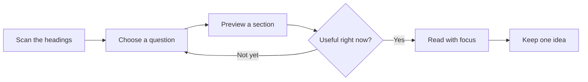

# A quieter way to read long pages

Structure should help you stay oriented without competing with the ideas you came to understand.

A long document is easier to approach when you can see its shape. You do not need to read every sentence in order, remember every heading, or keep your place through sheer concentration. A few quiet habits can make the page feel smaller.

**Field Notes · Reading systems · A practical guide**

[Start with the shape](#start-with-the-shape) · [Follow the reading rhythm](#follow-the-reading-rhythm) · [Finish where you started](#finish-where-you-started)

---

## Start with the shape

Before reading every sentence, notice how the page is organized. Headings reveal the argument, the sequence, and the places you may want to return to later.

A useful outline stays close enough to answer *“where am I?”* but quiet enough to disappear when your attention returns to the page.

### Find the main thread

Give the page a quick first pass:

1. Read the title and opening paragraph.
2. Scan the main headings for the questions the document answers.
3. Choose the section that connects to what you need right now.
4. Return to the introduction when you want the wider context.

You are building a map, not committing to a route. It is fine to begin in the middle.

### Keep context nearby

An outline is most useful when it preserves relationships. A small detail belongs to a larger idea, and that idea belongs to the document as a whole.

| When you want to… | Try this | What it gives you |
| --- | --- | --- |
| Understand the argument | Scan the main headings | A view of the whole page |
| Find one answer | Search for a heading | A shorter path to the relevant section |
| Explore a nearby idea | Preview before jumping | Context without a firm detour |
| Share something useful | Copy a section link | A precise place to start reading |

> Structure is a handrail, not a set of instructions. Use as much of it as you need.

## Reduce the search space

A page can contain many useful details without asking you to consider all of them at once. Start broad, then reveal depth as your question becomes more specific.

### Use memorable language

Headings work best when they describe an idea rather than a position. **“Keep context nearby”** is easier to recognize later than **“Additional information.”**

The same principle helps when you write your own notes:

```markdown
# Reading notes

## The question I came to answer
## The idea worth keeping
### A useful example
### A question to revisit
## What I will try next
```

Those headings are a writing example. They belong to the code block, rather than the outline of this guide.

### Collapse what you know

Once a section has done its job, you can fold its details away. The goal is to give your current question a little more room.

#### Leave a small trail

A short checklist can hold the next steps while you keep reading:

- [x] Identify the main question.
- [x] Find a section worth reading closely.
- [ ] Save one idea in your own words.
- [ ] Return to the detail that needs a second look.

> [!TIP]
> If you keep searching for the same thing, try a broader heading first. The answer may be described with different words.

## Follow the reading rhythm

Good tools adapt to the pace of the document. They are available during navigation and nearly invisible during focused reading.

The interface should preserve your place even when the page is long, dynamic, or deeply nested.

### Preview before committing

A quick glance at a nearby section can answer whether it is worth leaving your current position. Think of it as checking a signpost before taking a turn.



### Return without friction

Small directional controls make the top, bottom, and previous context easy to recover. A section link can do the same for someone else: it carries the starting point along with the recommendation.

In your own notes, a tiny helper can turn a section title into a readable anchor:

```javascript
function sectionAnchor(title) {
  return "#" + title
    .toLowerCase()
    .trim()
    .replace(/[^a-z0-9\s-]/g, "")
    .replace(/\s+/g, "-");
}

sectionAnchor("Follow the reading rhythm");
// → #follow-the-reading-rhythm
```

Different publishing tools generate anchors differently. When sharing an existing page, use its own section link when one is available.

### Make room for a pause

You do not have to finish a long guide in one sitting. A rough reading-time estimate can help you choose a comfortable stopping point.

For a section with $w$ words and a reading pace of $r$ words per minute:

$$
t = \frac{w}{r}
\qquad
\frac{900\ \text{words}}{225\ \text{words/minute}} = 4\ \text{minutes}
$$

That is a planning aid, not a target. Diagrams, unfamiliar ideas, and good questions deserve whatever time they need.

## Choose an appearance

On some pages, a glazed surface blends naturally into the background. On others, a solid panel creates clearer separation. The right choice is the one that lets you read comfortably.


*A little visual breathing room can make a dense page feel less demanding.*

### Let the page lead

Appearance can adapt while the interaction stays consistent. Keep the controls you use, remove the ones you do not, and choose an accent that is easy to recognize.

<details>
<summary>A small experiment for your next reading session</summary>
<h4>Try one quieter choice</h4>
<p>Read one section with the outline pinned open. Then unpin it and read another. Notice which arrangement helps you keep your attention on the ideas.</p>
<p>There is no correct result. Different documents—and different days—can call for different setups.</p>
</details>

## Keep the result local

Your reading notes do not need to become another project. A local Markdown file can hold a few headings, a useful link, and the next question you want to answer.

Use **bold** for the idea worth keeping, *italics* for a passing observation, and `inline code` for an exact setting or command. You can even cross out an assumption when it changes: ~~read everything in order~~ follow the question that matters.

> [!NOTE]
> Switching between Rendered and Raw gives you two views of the same document: one for reading its ideas, the other for working with its Markdown source.

### Finish where you started

Return to the question that brought you here. Can you answer it more clearly now? If so, keep the useful part and leave the rest available for later.

A good reading session does not always end at the bottom of the page. Sometimes it ends with one understood idea and a clear place to return.

[Back to the beginning](#a-quieter-way-to-read-long-pages)
