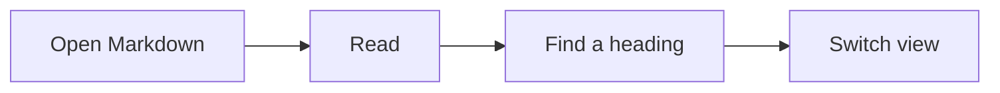

# A quieter Markdown reader

This document tests **Rendered / Raw**, source-position preservation, safe HTML, diagrams, and math. [Jump to the final section](#last-section).

## Reading essentials

- A regular list item
- [x] A completed task
- [ ] An incomplete task

| Feature | Expected result |
| --- | --- |
| Raw | Exact Markdown text |
| Rendered | A readable document |
| Outline | Works in both views |


### Code samples are not headings

```markdown
# This is not an outline heading
## Neither is this
```

```javascript
const greeting = "Hello, Crumbs";
console.log(greeting);
```

## Diagrams



### Invalid content stays readable

```mermaid
not a valid diagram
```

## Mathematics

Inline $E = mc^2$ and \(a^2 + b^2 = c^2\).

$$
\int_0^1 x^2 \, dx = \frac{1}{3}
$$

Invalid formula: $\unknownCrumbsCommand{x}$.

## Disclosures and safe HTML

<details>
<summary>Open to reveal another heading</summary>
<h3>Inside the disclosure</h3>
<p>This heading belongs in the Rendered outline only while the disclosure is open.</p>
</details>

Some <strong>safe inline HTML</strong> with an <a href="#last-section">internal link</a>.

## Long-form section

Crumbs is a reader and an outline. The reader remains available when the outline is hidden. Paragraphs and sections retain a source mapping so switching representation keeps the current part of the document nearby.

> A document can be read without becoming a dashboard.

### More content

Resize the browser and dock the outline left or right. The extra view control should fit within the same total height budget. Raw should retain source punctuation and whitespace, while Rendered uses a comfortable reading width.

## Last section

Use the outline to jump here in either view. The result should be visible, and the Raw choice should persist when you refresh this document. A different document should start Rendered.
